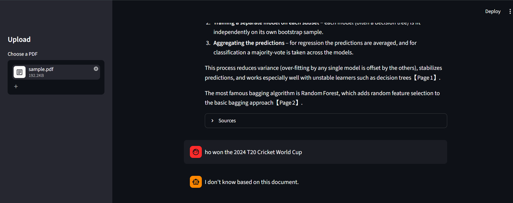

# 📄 Chat with your Document: RAG-Based Q&A App

Upload a PDF, ask questions in plain English, and get answers with **page-number citations**. If the document doesn't contain the answer, the app says *"I don't know"* instead of making something up.

---

## Table of Contents
* [Overview](#overview)
* [Problem Statement](#problem-statement)
* [Tools and Technologies](#tools-and-technologies)
* [Project Structure](#project-structure)
* [Key Insights](#key-insights)
* [Output](#output)
* [How to Run This Project?](#how-to-run-this-project)
* [Results & Conclusion](#results--conclusion)
* [Future Work](#future-work)
* [Author & Contact](#author--contact)

---

## Overview

This project is a **Retrieval-Augmented Generation (RAG)** application. Instead of asking a language model to answer from memory, the app first finds the most relevant parts of your own document and then asks the model to answer **using only those parts**. This makes answers more accurate, traceable, and far less likely to be hallucinated.

**Main features**
- Upload any text-based PDF through a web interface
- Ask questions in a chat interface
- Answers include page citations such as `[Page 2]`
- A "Sources" panel shows the exact text used for each answer
- Relevance threshold: refuses to answer when nothing relevant is found
- Built-in evaluation script to measure answer quality

---

## Problem Statement

Reading long documents (research papers, lecture notes, manuals, reports) to find one specific answer is slow. General-purpose chatbots can answer questions quickly, but they:

- do not know the contents of your private document,
- may **hallucinate** (confidently give wrong answers), and
- usually give no way to verify where an answer came from.

**Goal:** Build an app that answers questions strictly from a user-provided document, shows where each answer came from, and clearly says "I don't know" when the document has no answer.

---

## Tools and Technologies

| Category | Tool | Purpose |
|---|---|---|
| Language | Python 3.10+ | Core programming language |
| Web UI | Streamlit | Upload, chat interface, session state |
| PDF parsing | pypdf | Extract text page by page |
| Embeddings | sentence-transformers (`all-MiniLM-L6-v2`) | Convert text into vectors (runs locally, free) |
| Vector database | ChromaDB | Store embeddings and run similarity search |
| LLM | Groq API (`openai/gpt-oss-120b`) | Generate answers from retrieved context |
| Config | python-dotenv | Keep the API key out of the code |
| Version control | Git & GitHub | Source control |

---

## Project Structure

```
RAG Project/
├── app.py                  # Streamlit web app (upload, chat, sources)
├── rag.py                  # Core RAG logic (load, chunk, embed, retrieve, answer)
├── eval.py                 # Evaluation script (accuracy + refusal tests)
├── requirements.txt        # Python dependencies
├── sample.pdf              # Sample document used for testing
├── .env                    # API key (NOT committed to Git)
├── .gitignore              # Ignores .env and venv/
├── images/                 # App screenshots used in this README
│   ├── image 1.png
│   └── image 2.png            
└── README.md               # Project documentation
```
---

## Key Insights

- **Chunk overlap matters.** Overlapping chunks stop ideas from being cut in half at chunk boundaries, which improves retrieval.
- **A relevance threshold prevents hallucination.** Setting `MAX_DISTANCE` means irrelevant questions (for example "Who won the World Cup?") are refused before the LLM is even called.
- **Cosine distance** compares the *meaning direction* of vectors rather than their length, so it suits text embeddings.
- **Prompt design reduces hallucination.** The system prompt restricts the model to the given context and requires page citations.
- **`temperature=0`** keeps answers consistent and factual, which suits Q&A.
- **Specific questions work best.** Questions like "What is stacking?" work well, while vague ones like "explain this PDF" fail because RAG retrieves a few specific chunks rather than reading the whole file.
- **External APIs change.** The LLM model name is a single config variable (`MODEL` in `rag.py`), so it can be swapped in one line when a provider retires a model.

---

## Output

### Answer with citations

)

### Refusal when the answer is not in the document
[I don't know]()

**Example**

| Question | Response |
|---|---|
| What is Bagging? | Explains bootstrap sampling and aggregation, with `[Page 1]` and `[Page 2]` citations |
| What is stacking? | Explains base learners and the meta-model, with page citations |
| Who is my best friend? | *I don't know based on this document.* |

---

## How to Run This Project

### 1. Clone the repository
```bash
git clone https://github.com/YOUR_USERNAME/YOUR_REPO_NAME.git
cd YOUR_REPO_NAME
```

### 2. Create and activate a virtual environment
```bash
python -m venv venv

# Windows (PowerShell)
venv\Scripts\activate

# Mac / Linux
source venv/bin/activate
```

### 3. Install dependencies
```bash
pip install -r requirements.txt
```

### 4. Add your Groq API key
Get a free key from [console.groq.com](https://console.groq.com), then create a file named `.env` in the project folder:
```
GROQ_API_KEY=your_api_key_here
```
No quotes and no spaces around `=`.

### 5. Run the app
```bash
streamlit run app.py
```
Open `http://localhost:8501`, upload a PDF from the sidebar, and start asking questions.

### 6. (Optional) Run the evaluation
```bash
python eval.py
```

### Troubleshooting
| Problem | Fix |
|---|---|
| `401 Invalid API Key` | Check `.env` holds your full key, then **restart** the app |
| `404 model_not_found` | Update `MODEL` in `rag.py` to a model your account can access |
| "No text found" | The PDF is scanned or image-based; use a text-based PDF |
| Says "I don't know" too often | Increase `MAX_DISTANCE` in `rag.py` (for example 0.85) |

---

## Results & Conclusion

### Evaluation (`python eval.py`)

| Metric | Result |
|---|---|
| In-scope questions answered correctly | **X / 5** |
| Out-of-scope questions correctly refused | **Y / 3** |

_Replace X and Y with your actual results._

### Conclusion

The app shows that a small RAG pipeline can deliver **grounded, verifiable answers** from a private document. Page citations let users check every answer, and the relevance threshold lets the system refuse questions it cannot answer instead of hallucinating. The whole pipeline (embeddings, vector search, generation) runs on free tools.

**Limitations**
- Scanned or image-only PDFs are not supported (no OCR)
- Only one document is handled at a time
- Whole-document summaries are weak, since only the top few chunks are retrieved
- The vector database is in-memory, so data is lost when the app restarts

---

## Future Work

- **Multi-document support** with per-document filtering
- **Persistent vector storage** so documents survive restarts
- **Reranking** retrieved chunks with a cross-encoder for better precision
- **Hybrid search** combining keyword (BM25) and vector search
- **OCR support** (for example Tesseract) for scanned PDFs
- **Summary mode** using map-reduce over all chunks
- **Streaming responses** for a faster-feeling chat
- **Stronger evaluation** with a larger question set and automatic grading
- **Deployment** with Docker or Streamlit Community Cloud

---

## Author & Contact

**Tejas Pakhale**

- LinkedIn: https://www.linkedin.com/in/tejas-pakhale-411785264/
- GitHub: https://github.com/Tejaspakhale
- Email: pakhaletejas539@gmail.com
